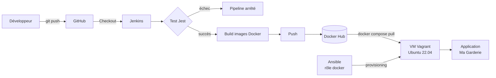

# 🧸 Ma Garderie : Chaîne CI/CD DevOps

Projet de fin de module (Master DevOps & Cloud) : mise en place d'une chaîne **CI/CD Jenkins** et déploiement d'une application web avec **Docker, Vagrant et Ansible**.

## 1. Présentation de l'application

**Ma Garderie** est une landing page responsive pour une garderie d'enfants. Elle est composée de trois composants Next.js :

| Composant | Rôle |
|---|---|
| **Navbar** | Logo, nom de la garderie et menu de navigation |
| **Hero** | Image, titre de bienvenue et description |
| **Services** | Services proposés par la garderie, chargés depuis l'API |

Le frontend récupère dynamiquement ses données auprès d'un backend Express qui expose trois API REST.

### Technologies utilisées

| Domaine | Technologie |
|---|---|
| Frontend | Next.js 15, React 19, TypeScript |
| Backend | Node.js 20, Express |
| Tests | Jest, React Testing Library |
| Conteneurs | Docker, Docker Compose |
| CI/CD | Jenkins (Pipeline as Code), Docker Hub |
| Infrastructure | Vagrant (provider libvirt), Ubuntu Server 22.04 |
| Provisioning | Ansible (rôle `docker`) |
| Versioning | Git, GitHub (workflow par branches) |

### API REST

| Méthode | Route | Description |
|---|---|---|
| GET | `/api/garderie` | Informations générales de la garderie |
| GET | `/api/services` | Liste des services proposés |
| GET | `/api/activites` | Liste des activités |

## 2. Architecture

### Structure du dépôt

```
garderie-devops/
├── backend/               API Express + Dockerfile
├── frontend/              Application Next.js + test Jest + Dockerfile
├── ansible/
│   ├── ansible.cfg
│   ├── inventory.ini      Inventaire
│   ├── site.yml           Playbook principal
│   └── roles/docker/      Rôle d'installation de Docker
├── deploy/
│   ├── docker-compose.yml Déploiement avec les images Docker Hub
│   └── .env               Nom d'utilisateur Docker Hub
├── docker-compose.yml     Build et exécution locale
├── Jenkinsfile            Pipeline CI/CD
├── Vagrantfile            VM Ubuntu + provisioning Ansible
└── README.md
```

### Chaîne CI/CD



### Architecture de déploiement

```
Navigateur ──► VM (192.168.56.10)
               ┌──────────── réseau Docker garderie-net ────────────┐
               │  frontend (Next.js :3000) ──► backend (Express :5000) │
               └────────────────────────────────────────────────────┘
```

Le frontend appelle le backend via le nom de service Docker `backend` grâce à la variable d'environnement `BACKEND_URL`.

### Workflow Git

Une branche par partie, fusionnée dans `main` : `feature/vagrant`, `feature/ansible`, `feature/deployment`, `docs/readme`.

## 3. Création et provisioning de la VM

**Prérequis** : Vagrant, libvirt/KVM (plugin `vagrant-libvirt`), rsync.

```bash
git clone https://github.com/MaramMiadi/garderie-devops.git
cd garderie-devops
vagrant up --provider=libvirt
```

| Caractéristique | Valeur |
|---|---|
| Système | Ubuntu Server 22.04 (`generic/ubuntu2204`) |
| Mémoire | 2 Go |
| CPU | 2 vCPU |
| Réseau privé | IP fixe `192.168.56.10` |
| Ports redirigés | 3000 (frontend) et 5000 (backend) |

Vérifier l'accès SSH :

```bash
vagrant status
vagrant ssh
```

### Provisioning avec Ansible

Le `Vagrantfile` exécute le playbook `ansible/site.yml` dans la VM (provisioner `ansible_local`). Le rôle **`docker`** :

1. installe les prérequis et ajoute le dépôt officiel Docker ;
2. installe Docker Engine et le plugin Docker Compose ;
3. démarre et active le service Docker ;
4. ajoute l'utilisateur `vagrant` au groupe `docker`.

```bash
vagrant provision
vagrant ssh -c "docker --version && docker compose version && systemctl is-active docker && id vagrant"
```

## 4. Exécution du pipeline Jenkins

1. Installer Jenkins, Node.js 20 et Docker sur la machine hôte, puis ajouter l'utilisateur `jenkins` au groupe `docker`.
2. Dans **Manage Jenkins → Credentials**, créer un identifiant *Username with password* d'ID `dockerhub-credentials` (utilisateur Docker Hub + **token d'accès** en mot de passe). Aucun identifiant n'est stocké dans le dépôt.
3. Créer un job **Pipeline** : *Pipeline script from SCM* → Git → `https://github.com/MaramMiadi/garderie-devops.git` → branche `*/main` → Script Path `Jenkinsfile`.
4. Cliquer sur **Build Now**.

| Étape | Action |
|---|---|
| Checkout | Récupération du code depuis GitHub |
| Install | `npm install` (frontend et backend) |
| Test | `npm test` : le pipeline s'arrête en cas d'échec |
| Build Frontend | Construction de l'image Docker du frontend |
| Build Backend | Construction de l'image Docker du backend |
| Push Frontend | Publication sur Docker Hub |
| Push Backend | Publication sur Docker Hub |

## 5. Images Docker Hub

- Frontend : https://hub.docker.com/r/miadi/garderie-frontend
- Backend : https://hub.docker.com/r/miadi/garderie-backend

## 6. Déploiement avec Docker Compose

Le déploiement utilise uniquement les images publiées sur Docker Hub (aucune construction locale), via `deploy/docker-compose.yml`.

Depuis l'hôte, avec le provisioner `deploy` :

```bash
vagrant rsync
vagrant provision --provision-with deploy
```

Ou directement dans la VM :

```bash
vagrant ssh
cd /vagrant/deploy
docker compose pull
docker compose up -d
docker compose ps
```

Vérification des API :

```bash
curl http://localhost:5000/api/garderie
curl http://localhost:5000/api/services
curl http://localhost:5000/api/activites
```

## 7. Accès à l'application déployée

| Depuis | Adresse |
|---|---|
| La machine hôte | http://192.168.56.10:3000 |
| Une autre machine du réseau | http://192.168.199.169:3000 (IP de l'hôte, port redirigé) |
| API backend | http://192.168.199.169:5000/api/garderie |

## 8. Exécution locale (développement)

```bash
docker compose up --build
```

Frontend : http://localhost:3000, backend : http://localhost:5000.

## Auteur

Maram Miadi